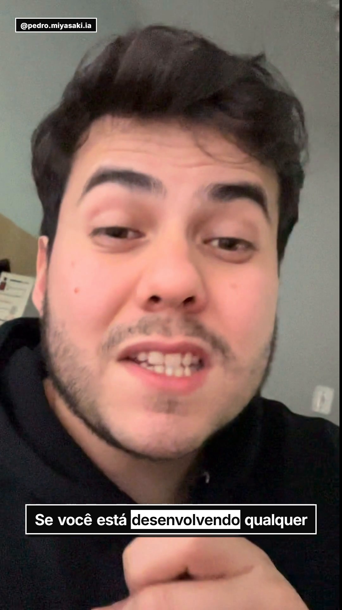

# Comportamentos padrão de edição

Leia este documento antes de preparar o plano de sequência. Toda edição conduzida por `editar-video`, independentemente da categoria, inclui estes dois comportamentos sem o usuário precisar pedi-los novamente:

1. Legendar a fala com o padrão `legenda-evals`.
2. Cortar espaço morto rente à fala.

Uma orientação explícita do usuário para aquele vídeo pode alterar ou dispensar um deles. Registre a exceção no plano; não trate a ausência de um pedido de legenda ou de cortes como dispensa. Se não houver fala ou espaço morto, registre que o respectivo comportamento não se aplica, sem inventar conteúdo ou cortes.

## 1. Legenda de fala: legenda-evals

A referência está no catálogo visual desta skill. Reutilize-a, sem escolher outro preset de legenda nem consultar composições de vídeos anteriores.

**Antes de compor, leia a seção [Legenda de evals](video-patterns.md#legenda-de-evals).** Ela é a fonte canônica das medidas, cores, fonte, agrupamento e comportamento. O print abaixo guarda o enquadramento já exportado. Ele é da identidade anterior. As cores e a fonte vigentes são as desta spec (Miyakodo).

### Como deve aparecer e se comportar

- Caixa em dark brown (`#280e03`) com borda off-white (`#f6f4ee`), cantos retos e texto off-white, centralizada na região inferior sem cobrir a boca. No canvas de 1080 × 1920, a referência usa Poppins local, 48 px e peso 600 (SemiBold). Use as demais medidas do catálogo; adapte posição e escala quando o formato exigir.
- O grupo de palavras aparece inteiro desde o começo. Apenas a palavra que está sendo pronunciada recebe fundo off-white e texto dark brown; ao terminar, volta ao estado normal. Não revelar a frase palavra por palavra nem movimentar o texto a cada destaque.
- Uma caixa por vez, com até duas linhas e quebras por sentido. O ponto de partida do agrupamento é até seis palavras, 36 caracteres e 2,7 s, não blocos rígidos que cortem o sentido.
- Transcrever a fala, corrigindo erros de reconhecimento e grafia, sem reescrever o que foi dito. Não inventar legendas em trechos sem fala.
- Usar timestamps por palavra na **timeline editada**. Recalcular depois dos cortes e de alterações de velocidade. A legenda acompanha também os inserts, sem ficar presa a uma frase anterior depois de um corte.
- Carregar `/media-use` para transcrição e as skills de implementação indicadas pelo roteador HyperFrames. Implementar com as medidas e o comportamento do catálogo local, sem importar código ou tempos de projetos anteriores.

Não importar outros elementos presentes no print, como o label do perfil: o padrão aqui é somente a legenda.

## 2. Corte de espaço morto rente à fala

**Intenção:** ritmo de conteúdo curto, com quase nenhum tempo vazio entre frases. Cortar o mais perto possível de onde o som da fala de fato começa e termina, sem sacrificar sílabas para ganhar milissegundos.

- Identificar silêncios no início, entre frases e no final. Transcrição e detecção de silêncio sugerem os pontos; conferir o áudio nas bordas, pois timestamps de palavras e limiares de volume podem ignorar consoantes fracas e finais de palavra.
- Encerrar o trecho mantido logo depois do último som da frase e iniciar o próximo imediatamente antes do primeiro som da fala. Manter apenas a margem mínima necessária para não truncar o áudio nem criar estalos, sem acrescentar uma folga fixa perceptível em cada corte.
- Remover esperas e respirações isoladas que constituam espaço morto. Não cortar respiração sobreposta à voz nem eliminar pausas internas necessárias à compreensão só por terem baixo volume.
- Manter imagem e áudio sincronizados. Este padrão não autoriza acelerar a fala, remover palavras, reordenar frases ou reescrever o conteúdo.
- Preservar o vídeo original. Registrar os intervalos mantidos e removidos no arquivo de origem e seu mapeamento para a timeline editada; usar esse mapeamento também para sincronizar as legendas.

## Padrões opcionais (desligados por padrão)

Estes dois padrões ficam desligados no uso geral, mas podem ser ativados por um modo de edição documentado. Leia o arquivo do modo escolhido antes do plano; o estado especificado pelo modo prevalece sobre o default abaixo. O usuário pode pedir explicitamente que qualquer um fique desligado naquela edição. Cada padrão é ativado separadamente, e usá-lo num vídeo não altera o default de edições futuras. Sem modo que o ative, só ligue um padrão se o usuário o pedir para esta edição.

- **Label do perfil (`perfil-pb`):** identificação `@pedro.miyasaki.ia` no canto superior esquerdo. **Desligada por padrão fora de um modo que a ative.** Seguir as medidas e o comportamento de [Perfil PB](video-patterns.md#perfil-pb).
- **Aviso de 2x (`aviso-2x`):** label `SEGURE PARA 2X`. **Desligado por padrão fora de um modo que o ative.** Seguir o visual e a animação de [Aviso 2x](video-patterns.md#aviso-2x), ajustando o trecho e a posição à edição. É apenas um aviso visual: não acelera a exportação.

## No plano e na conferência

- Declarar os dois comportamentos automáticos em `plano.md`, separados do pedido literal do usuário. Preencher a duração prevista com base nos cortes propostos.
- Registrar `perfil-pb` e `aviso-2x` como desligados ou ligados pelo modo/pedido que os autorizou. Quando `aviso-2x` estiver ligado, incluir seu trecho e sua posição no plano.
- Mostrar uma amostra estática da legenda sobre um frame do vídeo, com uma palavra destacada. Reutilizar essa amostra enquanto o visual não mudar; não gerar uma imagem para cada grupo de palavras.
- Listar os cortes com os intervalos de origem, a posição na timeline editada e o tempo removido. Cortes de silêncio podem ser apresentados em uma lista compacta, sem uma captura por corte. Uma imagem sozinha não comprova a qualidade da emenda: ouvir trechos curtos nas bordas durante a conferência.
- O plano continua sujeito à aprovação do usuário. Aplicar esses padrões não autoriza montar ou renderizar o vídeo completo antes do "pronto".

Fora de um modo que os ative, `perfil-pb`, `aviso-2x`, símbolos da marca, imagens, zooms, trilha e animações extras ficam desligados, salvo pedido explícito. Um modo documentado pode definir suas próprias intervenções, como descrito em seu arquivo. Este documento não define modos; consulte `padroes-de-edicao/` para os modos disponíveis.
