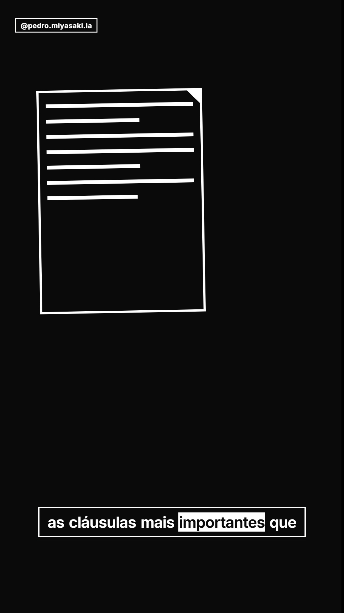

# Padrões de edição de vídeo

Três elementos recorrentes dos vídeos de Pedro Miyasaki: identificação do perfil, legenda de fala e aviso de reprodução em 2x. Este catálogo, os prints e as fontes ficam dentro de `editar-video`; ele é autossuficiente para reproduzir os padrões, sem consultar projetos anteriores. Estes nomes podem ser usados diretamente num pedido de edição.

| Nome | Também pode ser chamado de | Uso |
|---|---|---|
| `perfil-pb` | label do perfil, perfil preto e branco, label do Instagram | Identificação no canto superior esquerdo. Usar quando solicitada ou ativada por um modo documentado. |
| `legenda-evals` | legenda padrão, legenda de evals, legenda preta e branca, legenda PB | Padrão das legendas de fala nas próximas edições. |
| `aviso-2x` | label 2x, aviso para acelerar, segure para 2x, aperte 2x para acelerar | Usar quando solicitado ou ativado por um modo documentado; fora disso, fica desligado. |

Os apelidos "preto e branco" e "PB" continuam identificando estes padrões. Fundo escuro e tinta: dark brown `#280e03`. Papel e texto claro: off-white `#f6f4ee`.

Exemplos de pedido:

> Edite este vídeo com perfil-pb e legenda-evals.

> Use os padrões do projeto e coloque aviso-2x quando eu apontar para baixo.

> Use legenda padrão e label do perfil, sem aviso 2x.

## Como aplicar

As medidas abaixo são do canvas de **1080 × 1920**, com **Poppins** local, tinta dark brown `#280e03`, papel off-white `#f6f4ee` e cantos retos. Os arquivos são TTF estáticos. A legenda usa SemiBold (600), o perfil usa Bold (700) e o aviso usa ExtraBold (800). Em outro formato, preserve o tratamento visual e ajuste a posição ao enquadramento e às áreas ocupadas pela interface da plataforma.

A origem da marca é `design/identity.md`. As fontes saem de `design/fontes/` (`poppins.zip` e `instrument-serif.zip`). Estes três overlays usam Poppins, a família de corpo. As cópias para render ficam em `assets/fonts/`:

- [Poppins-SemiBold.ttf](assets/fonts/Poppins-SemiBold.ttf), peso 600
- [Poppins-Bold.ttf](assets/fonts/Poppins-Bold.ttf), peso 700
- [Poppins-ExtraBold.ttf](assets/fonts/Poppins-ExtraBold.ttf), peso 800

A licença SIL OFL está em [Poppins-OFL.txt](assets/fonts/Poppins-OFL.txt). No mesmo diretório estão `Poppins-Regular.ttf` (corpo, peso 400) e Instrument Serif (`InstrumentSerif-Regular.ttf`, `InstrumentSerif-Italic.ttf`, licença [InstrumentSerif-OFL.txt](assets/fonts/InstrumentSerif-OFL.txt)), para títulos quando um modo pedir. Copie para os assets do projeto em curso os arquivos que a peça usa. No `@font-face`, use `format("truetype")`, uma URL local ao projeto e o peso do arquivo. Declare Poppins sempre como `font-family: "Poppins"`, com `font-style: normal`. SemiBold e ExtraBold trazem o peso no nome interno da família; o `font-weight` do `@font-face` é o que vale. Instrument Serif usa `font-family: "Instrument Serif"`, peso 400, com `font-style: italic` só no arquivo itálico. Sem apontar para pastas de outros vídeos, para os zips ou para fontes remotas.

Carregue as skills exigidas pela operação de HyperFrames. Estes padrões definem o visual e o comportamento dos overlays, sem definir cortes, zooms, trilha, inserts ou o roteiro inteiro. No brief, registre os nomes utilizados e qualquer adaptação pedida para aquela peça. As instruções do pedido atual prevalecem sobre os defaults.

Os prints preservam o enquadramento da identidade anterior. As cores, a fonte e os números deste catálogo são a referência vigente (Miyakodo). A paleta completa está em `design/identity.md`; estes overlays usam o par `#280e03` e `#f6f4ee`. Para estes três overlays, use esta especificação em vez de importar medidas ou código de outra peça ou de templates de carrossel. Não é necessário ler nenhum projeto antigo para implementar estes elementos.

## Perfil PB

Nome para chamar: **`perfil-pb`**.

Texto literal: **`@pedro.miyasaki.ia`**, em minúsculas. Esta é a grafia dos arquivos e das exportações do projeto.

| Propriedade | Valor |
|---|---|
| Posição | `position: absolute; top: 56px; left: 48px` |
| Largura | `width: max-content` |
| Padding | `10px 14px 8px` |
| Fundo e texto | `background: #280e03; color: #f6f4ee` |
| Borda | `3px solid #f6f4ee` |
| Fonte | `Poppins`, `22px`, peso `700` |
| Espaçamento e entrelinha | `letter-spacing: 0.02em; line-height: 1` |
| Camada | Acima do vídeo e dos inserts, abaixo das legendas |

A label permanece no canto superior esquerdo durante a peça, inclusive sobre footage e inserts. O texto não acompanha o zoom do vídeo. Este padrão não exige animação de entrada nem saída. Não adicionar sombra, textura ou caixa alta à versão canônica.

As medidas acima e o print abaixo consolidam a referência do perfil; não é necessário consultar sua implementação em um vídeo anterior.

Print da exportação de evals em 1x, em 31,5 s:

O print é da identidade anterior. As cores e a fonte vigentes são as desta spec (Miyakodo).

## Legenda de evals

Nome para chamar: **`legenda-evals`**.

Uma caixa em dark brown `#280e03` com borda off-white `#f6f4ee`, centralizada na região inferior. O grupo de palavras aparece inteiro; a palavra falada recebe fundo off-white e texto dark brown enquanto é pronunciada. Não é uma revelação progressiva da frase.

| Propriedade | Valor |
|---|---|
| Posição | `position: absolute; inset: auto 72px 238px; margin: 0 auto` |
| Largura | `width: max-content; max-width: 936px` |
| Padding da caixa | `18px 24px 15px` |
| Fundo e texto | `background: #280e03; color: #f6f4ee` |
| Borda | `4px solid #f6f4ee` |
| Sombra | `9px 9px 0 rgba(40, 14, 3, 0.8)` |
| Fonte | `Poppins`, `48px`, peso **`600`** |
| Espaçamento e entrelinha | `letter-spacing: -0.025em; line-height: 1.12` |
| Composição | `text-align: center; text-wrap: balance`, até duas linhas |
| Cada palavra | `display: inline; padding: 1px 2px 0; box-decoration-break: clone; -webkit-box-decoration-break: clone` |
| Camada | Acima do vídeo, do perfil e dos gráficos |

Use timestamps por palavra, corrigidos para a timeline depois dos cortes e de qualquer alteração de velocidade. Preserve a fala, corrigindo erros de transcrição e grafia. Há um grupo de legenda visível por vez, tanto sobre o vídeo quanto sobre inserts, sem cobrir a boca.

O agrupamento de origem usa até **seis palavras**, **36 caracteres** e **2,7 s**, com quebra depois de fim de frase. São pontos de partida para segmentar a fala; ajuste a quebra para respeitar o sentido e o limite de duas linhas, em vez de criar blocos iguais mecanicamente.

Ao iniciar uma palavra, defina `color: #280e03` e `backgroundColor: #f6f4ee`; ao terminar, retorne a `color: #f6f4ee` e `backgroundColor: transparent`. O destaque muda por timestamp, sem alterar o tamanho ou a posição do texto. A caixa pode permanecer até 25 ms antes da próxima legenda; a última pode ter 120 ms de sustentação, sempre respeitando o fim do trecho e os cortes. Pausas longas podem encerrar a caixa antes para que uma frase antiga não fique presa na tela.

Na versão HTML de HyperFrames, cada palavra recebe seu próprio ``, com identificador único. O destaque pode usar `timeline.set` nos tempos de início e fim da palavra. Mantenha todos os grupos numa track de captions, usando clips e subcomposições conforme o contrato atual de HyperFrames; dentro de uma subcomposição, converta os tempos para sua origem local.

As medidas, a regra de agrupamento e a troca de destaque acima consolidam a implementação da legenda. Não reutilize scripts, transcrições ou timestamps de um vídeo anterior.

Print da exportação de evals em 1x, em 1 s:

O print é da identidade anterior. As cores e a fonte vigentes são as desta spec (Miyakodo).

## Aviso 2x

Nome para chamar: **`aviso-2x`**.

Texto da versão existente: **`SEGURE PARA 2X`**. O apelido "aperte 2x para acelerar" identifica este mesmo padrão. Se o pedido especificar outro texto literal, use esse texto com o mesmo tratamento visual.

| Propriedade | Valor |
|---|---|
| Posição de referência | `position: absolute; top: 1704px; left: 112px` |
| Padding | `9px 12px 7px` |
| Fundo e texto | `background: #280e03; color: #f6f4ee` |
| Borda | `4px solid #f6f4ee` |
| Sombra | `6px 6px 0 rgba(40, 14, 3, 0.8)` |
| Fonte | `Poppins`, `20px`, peso `800` |
| Espaçamento e entrelinha | `letter-spacing: 0.08em; line-height: 1` |
| Composição | `text-transform: uppercase; white-space: nowrap` |
| Origem de transformação | `transform-origin: 0% 70%` |
| Duração de referência | `3.4s` |

A posição de referência acompanha o dedo apontando para baixo no vídeo de evals e fica abaixo da caixa de legenda. A posição e o momento de entrada dependem do gesto, do enquadramento e da interface da plataforma; não reutilize automaticamente o timestamp do vídeo antigo. Mantenha a label livre do rosto, da legenda e de outros elementos importantes. Ela é um aviso visual, não um botão dentro do vídeo.

Movimento da versão de evals, em tempos locais do clip:

- Começa com `opacity: 0`, `scale: 0.86`, `y: 12`.
- Em `0.12s`, entra até `opacity: 1`, `scale: 1`, `y: 0`, durante `0.34s`, com `power3.out`.
- Em `3.05s`, sai até `opacity: 0`, durante `0.22s`, com `power1.in`.
- O clip termina em `3.4s`. Anime o elemento interno da label, mantendo o clip responsável pelo tempo.

Use quando solicitado ou ativado por um modo documentado. Fora disso, não incluí-lo é válido, inclusive quando perfil e legenda usam os padrões do projeto. O aviso não altera a velocidade da exportação.

As medidas e os tempos locais acima especificam o aviso por completo. A posição pode ser adaptada ao enquadramento, sem criar outro padrão.

O print abaixo preserva uma revisão de evals em 8,6 s. Ele está incluído nesta skill; não é necessário buscar snapshots no projeto antigo. O aviso está nessa revisão, embora esteja ausente da exportação final em 1x usada nos outros dois prints.

O print é da identidade anterior. As cores e a fonte vigentes são as desta spec (Miyakodo).

## Conferência numa próxima edição

Confira o perfil e a legenda sobre footage e sobre um insert, quando houver. Observe a troca de destaque entre palavras, uma quebra em duas linhas e um corte de fala. Quando usar o aviso 2x, confira a entrada e a saída no trecho escolhido e a convivência com as legendas e a interface da plataforma. Compare com os prints deste catálogo, depois execute as verificações exigidas pelas skills ativas.
