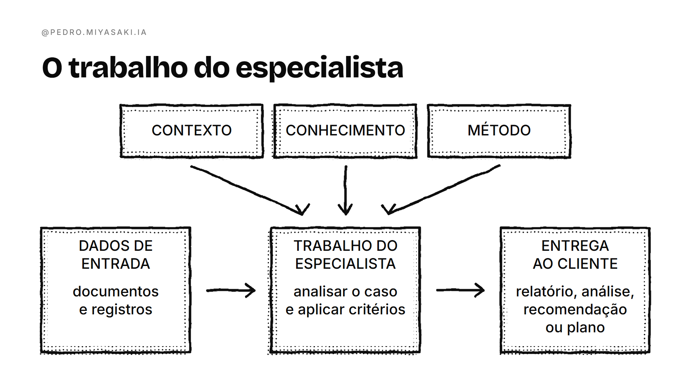
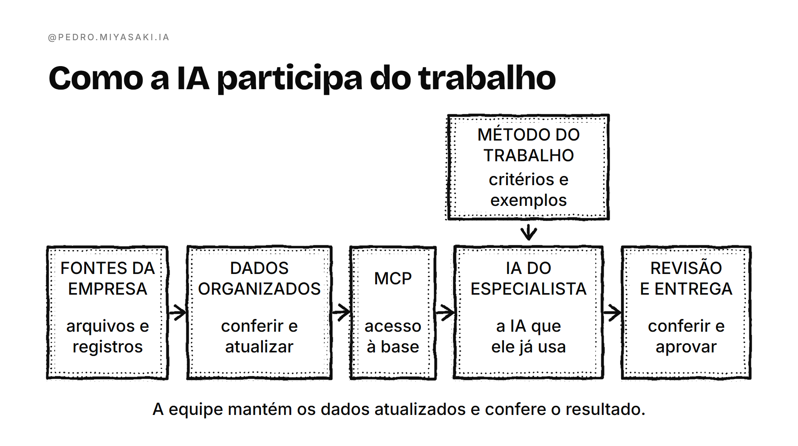

# IA no trabalho de especialistas

### O padrão de negócio de muitas empresas de serviços permite uma implementação comum, com dados organizados, método registrado e IA no ambiente do profissional.

Muitas empresas de serviços especializados operam numa mesma abstração: **dados → especialista → output**. O cliente fornece documentos, registros e informações sobre o que precisa. Um profissional interpreta esse material e produz uma entrega contratada, como um relatório, uma análise ou um plano. Os assuntos variam, mas a estrutura de produção se repete: a empresa recebe os dados de um caso e aplica conhecimento especializado para chegar a um resultado pelo qual o cliente paga.

O especialista acrescenta contexto, conhecimento e método a essa entrada. Ele identifica quais dados importam, verifica se são confiáveis, cruza informações e aplica os critérios da profissão à situação do cliente. Parte desse trabalho segue procedimentos recorrentes; outra parte exige julgamento sobre as particularidades do caso. Essa combinação permite reaproveitar uma mesma estrutura técnica de IA em diferentes serviços, desde que os dados e o método de cada negócio estejam bem definidos.

## Por que eu começaria pelo copiloto

Vejo como excessivamente otimista a expectativa de substituir um profissional inteiro por um agente só porque conseguimos descrever algumas das suas tarefas. O trabalho real inclui heurísticas mentais que raramente aparecem num procedimento: perceber que um dado está estranho, reconhecer uma exceção, desconfiar de uma conclusão plausível ou entender que o cliente formulou mal o problema. A experiência também orienta quando aprofundar a análise, pedir informação ou interromper o trabalho. Uma lista de passos dificilmente captura tudo isso.

A automação completa exige lidar com essas decisões, com as exceções e com a responsabilidade pelo resultado. Em tarefas delimitadas e verificáveis, pode ser uma boa escolha. Para esse padrão de negócio, eu começaria delegando partes do preparo e da análise à IA, com o especialista conduzindo e aprovando a entrega. Por isso, considero sua participação uma condição de projeto: quem executa o serviço precisa definir o que é aceitável e mostrar os erros que comprometem a conclusão. É desse conhecimento que saem as consultas, instruções e etapas do copiloto.

## Como o padrão de negócio vira implementação

A primeira camada é a de dados. Documentos e registros precisam estar associados ao cliente e ao trabalho correto, com versões identificadas, duplicatas tratadas e divergências visíveis. Quando houver extração de informações dos documentos, cada campo relevante deve preservar a referência à fonte. Isso permite ao especialista conferir uma afirmação sem repetir toda a leitura.

Essa camada pode consultar sistemas distintos. Não exige concentrar tudo num único banco, mas exige definir quais dados estão disponíveis, como serão atualizados e quais permissões valem para cada usuário. O objetivo é oferecer consultas úteis ao serviço, como recuperar o histórico de um cliente ou localizar os documentos de um caso.

Uma forma de conectar essa camada ao aplicativo de IA que o profissional já usa é o [MCP](https://modelcontextprotocol.io/docs/learn/architecture). O protocolo permite expor dados e [ferramentas](https://modelcontextprotocol.io/docs/learn/server-concepts) para consulta e execução de operações. Uma ferramenta pode receber o identificador do caso e devolver os registros correspondentes. O que o agente consegue fazer depende da implementação e das permissões. A qualidade dos dados e da análise continua sendo responsabilidade do projeto.

A segunda camada é o método de trabalho. Skills permitem registrar padrões de tarefas que se repetem: conferir a documentação recebida, cruzar registros, preparar uma análise ou revisar um relatório. Cada uma reúne o objetivo da tarefa, os dados necessários, os passos, os critérios de qualidade e as condições em que o agente deve pedir ajuda. Exemplos aprovados ajudam a calibrar o resultado.

Um conjunto de skills do negócio, compartilhado entre os especialistas e bem auditado, acrescenta um ganho além do acesso aos dados. O time pode economizar o tempo de explicar novamente uma tarefa ao agente, reconstruir o procedimento e corrigir os mesmos desvios. Essa auditoria precisa usar casos reais para conferir se os passos são adequados, se as fontes sustentam a análise e se as exceções recebem o tratamento correto.

Essa organização também dá flexibilidade para mudar o método. Quando uma regra, etapa ou formato muda, a empresa atualiza e valida a skill correspondente, versiona a alteração e a disponibiliza ao time. O profissional pode combinar as skills pertinentes a cada caso, sem precisar transformar toda a sua atuação numa sequência rígida. O método fica registrado, pode ser revisado e continua sob controle de quem conhece o serviço.

É assim que o padrão técnico atende ao padrão de negócio: a IA consulta os dados do caso, segue os procedimentos da empresa e prepara o trabalho no ambiente do especialista. Dados e método podem ser mantidos separadamente, com responsáveis claros por cada um. A cada novo cliente, o time reaproveita essa estrutura e trabalha sobre o contexto específico daquela entrega.

## A conta precisa fechar por entrega aprovada

Eu começaria por um serviço recorrente, com volume suficiente para justificar o projeto e critérios de qualidade que a equipe saiba aplicar. Casos anteriores podem formar um conjunto de avaliação, incluindo exemplos de informação ausente e documentos contraditórios. Ele serve para verificar se mudanças no modelo, nas consultas ou nas instruções preservam a qualidade esperada.

A medida principal é o custo da entrega aprovada. Na comparação com o processo atual, entram horas de preparo, análise e revisão, correções necessárias, custo de uso da IA e manutenção das integrações. Uma primeira versão rápida tem pouco valor se o especialista precisa refazer o trabalho para aprová-la. A revisão precisa ser considerada desde o desenho do fluxo.

O teste também pode mostrar que o gargalo era outro. Se a equipe produz o relatório rapidamente, mas passa dias esperando uma informação do cliente, acelerar a redação vai mudar pouco o prazo. Já num trabalho que exige cruzar muitos registros antes de chegar à conclusão, dar ao agente acesso aos dados certos pode economizar uma parte relevante da análise.

Eu priorizaria esse padrão porque ele permite investir em capacidade de produção sobre um serviço que já tem demanda e receita. Se a empresa reduz o esforço por entrega sem perder qualidade, o ganho pode aparecer em margem, prazo ou capacidade de atendimento. É nesse resultado operacional que eu cobraria o retorno do projeto.

---

Palavras: 979 (corpo, sem título, subtítulo, intertítulos e legendas)
ACP: A · Audience
Estrutura: abstração dados, especialista e output; limites da substituição completa; implementação com dados e skills auditadas e compartilhadas; avaliação pelo custo da entrega aprovada
Imagens: 2 figuras conceituais + capa; artes e registros em sketch/shotlist.md
Fontes: https://modelcontextprotocol.io/docs/learn/architecture · https://modelcontextprotocol.io/docs/learn/server-concepts
Reuso de: tier-list-de-casos-de-uso-de-ia
